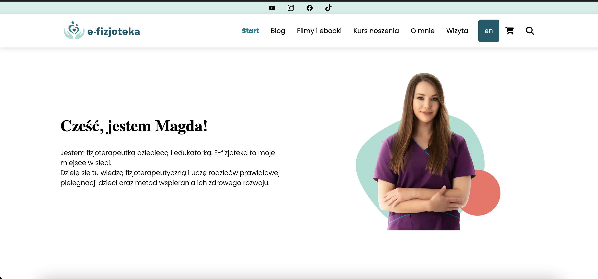
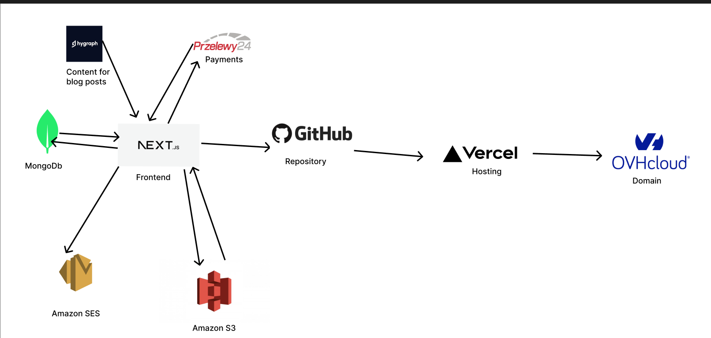
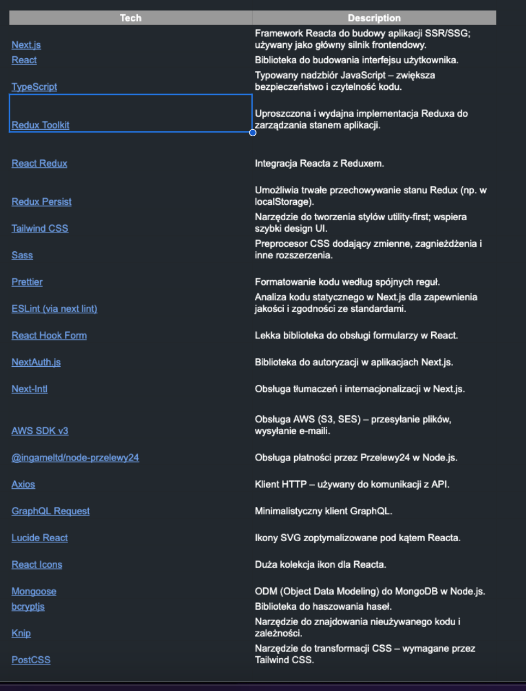
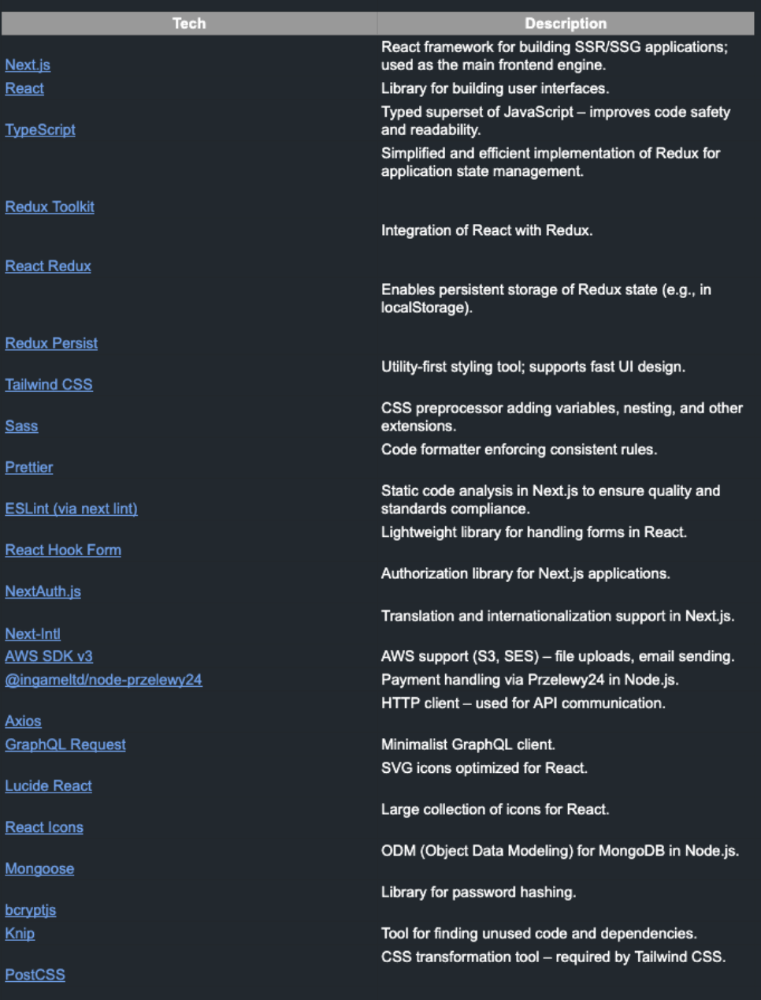

# Fizjoteka

## Ekrany aplikacji/ Screens for Appliacation



## Opis projektu / Project Description

### [POL]

Fizjoteka to pełnoprawna aplikacja zakupowa stworzona z myślą o elastyczności i łatwej obsłudze przez administratora.
Pozwala użytkownikom przeglądać i kupować produkty cyfrowe, a administratorom zarządzać całą zawartością poprzez dedykowany panel.
Projekt został stworzony jako praktyczne wdrożenie nowoczesnego e-commerce'u z wykorzystaniem narzędzi takich jak Next.js, MongoDB, Amazon S3/SES, oraz integracją z płatnościami i newsletterem.

### [ENG]

Fizjoteka is a fully-featured shopping application designed with flexibility and ease of use for administrators in mind.
It allows users to browse and purchase digital products, while administrators can manage all content through a dedicated panel.
The project was created as a practical implementation of modern e-commerce using tools such as Next.js, MongoDB, Amazon S3/SES, along with integration of payment systems and a newsletter.

## Architektura projektu



## TechStack




## Wymagania wstępne / Prerequisites

- **Node.js**: 18.17.0 (Zalecana: 22)
- **Git**: Wersja >2
- **Edytor kodu**: np. Visual Studio Code

- **Node.js**: 18.17.0 (Recommended: 22)
- **Git**: Version >2
- **Code editor**: e.g. Visual Studio Code

### Instalacja / Installation

1. Sklonuj repozytorium:
   ```bash
   git clone https://github.com/takimi12/Final-Zelwine
   ```
2. Zainstaluj zależności:
   ```bash
   npm install
   ```
3. Uruchom aplikację w trybie deweloperskim:

   ```bash
   npm run dev
   ```

4. Clone the repository:

```bash
git clone https://github.com/takimi12/Final-Fizjoteka2.git
```

2. Install dependencies:

```bash
npm install
```

3. Run the app in development mode:

```bash
npm run dev
```

## Link do aplikacji / Link for live app

https://fizjoteka2.vercel.app/

## Dostępy / Access


# Logowanie podstrona /login  / Login subpage /login

Admin

login:admin@admin.pl
password:123123123

Regular User

login: user@user.pl
password:123123123


kod rabatowy w koszyku  na rabat 20%/discount code in cart for 20% discount

KOBIETA2

Email, który należy podać podczas próby zapisania się do newslettera oraz podczas składania zamówienia

Email:
projektfizjoteki@op.pl

Hasło:
123a123A/!


## Opis projektu / Project Description

### [POL]

Fizjoteka to pełnoprawna aplikacja zakupowa stworzona z myślą o elastyczności i łatwej obsłudze przez administratora.  
Pozwala użytkownikom przeglądać i kupować produkty cyfrowe, a administratorom zarządzać całą zawartością poprzez dedykowany panel.  
Projekt został stworzony jako praktyczne wdrożenie nowoczesnego e-commerce'u z wykorzystaniem narzędzi takich jak Next.js, MongoDB, Amazon S3/SES, oraz integracją z płatnościami i newsletterem.

### [ENG]

Fizjoteka is a fully-featured shopping application designed with flexibility and ease of use for administrators in mind.  
It allows users to browse and purchase digital products, while administrators can manage all content through a dedicated panel.  
The project was created as a practical implementation of modern e-commerce using tools such as Next.js, MongoDB, Amazon S3/SES, along with integration of payment systems and a newsletter.

---

## Co zostało zrobione / What Has Been Done

### [POL]

W aplikacji zostały wprowadzone następujące funkcjonalności:

- **Internacjonalizacja**  
  Wsparcie dla języka polskiego i angielskiego

- **Baza danych**  
  Przechowywanie produktów w bazie danych **MongoDB**

- **Przechowywanie plików**  
  Wykorzystanie **Amazon S3** do przechowywania plików powiązanych z produktami

- **✉️ Wysyłka wiadomości e-mail**  
  Integracja z **Amazon SES** jako providerem do wysyłki wiadomości e-mail

- **Panel administratora**  
  Możliwość zarządzania zawartością aplikacji, w tym:

  - **Produkty**

    - Dodawanie, usuwanie, edycja produktów
    - Pola: `nazwa`, `cena`, `opis`, `kategoria`, `zdjęcie promocyjne`, `plik produktu`

  - **Kategorie**

    - Dodawanie, usuwanie, edycja kategorii
    - Pole: `nazwa`

  - **Newsletter**

    - Podgląd kontaktów zapisanych do newslettera

  - **✍️ Blog (Hygraph)**

    - Połączenie z **Hygraph** w celu dodawania i edycji postów

  - **Kody rabatowe**
    - Możliwość dodawania kodów rabatowych w panelu administratora
    - Obsługa kodów rabatowych w koszyku

- **Płatności**
  - Obsługa płatności za pomocą providera **Przelewy24**
  - Po zakończonej płatności:
    - Automatyczna wysyłka pliku produktu na adres e-mail użytkownika

### [ENG]

The following features have been implemented in the application:

- **Internationalization**  
  Support for both Polish and English languages

- **Database**  
  Storing products in a **MongoDB** database

- **File Storage**  
  Using **Amazon S3** to store files associated with products

- **✉️ Email Sending**  
  Integration with **Amazon SES** as the email sending provider

- **Admin Panel**  
  Ability to manage application content, including:

  - **Products**

    - Adding, deleting, and editing products
    - Fields: `name`, `price`, `description`, `category`, `promotional image`, `product file`

  - **Categories**

    - Adding, deleting, and editing categories
    - Field: `name`

  - **Newsletter**

    - Viewing contacts subscribed to the newsletter

  - **✍️ Blog (Hygraph)**

    - Integration with **Hygraph** for creating and editing blog posts

  - **Discount Codes**
    - Ability to add discount codes in the admin panel
    - Support for discount codes in the shopping cart

- **Payments**
  - Payment handling using **Przelewy24** as the provider
  - After a successful payment:
    - The product file is automatically sent to the user's email address

### Plany na przyszłość [POL]

Jest to deweloperska wersja aplikacji, która została oddana klientowi i zrealizowała wszystkie jego wymagania.  
W przyszłości, w celach naukowych, planowane jest połączenie tej aplikacji z wszystkimi polskimi providerami płatności, w celu oceny który z nich zapewnia najszybszą integrację z API.
Aplikacja korzysta z konta sandboxa Amazon SES, dlatego też, wysyłka produktu po podaniu e-maila oraz złożeniu zamówienia odbywa się tylko na e-mail dodany w koncie produkcyjnym Amazon ses. Jest to e-mail Email: projektfizjoteki@op.pl Hasło:123a123A/! założony w serwisie [https://www.onet.pl](https://konto.onet.pl/signin?state=https%3A%2F%2Fpoczta.onet.pl%2F&client_id=poczta.onet.pl.front.onetapi.pl)].  W przyszłości planowane jest złożenie wniosku o przyznanie dostępu produkcyjnego.
### Future Plans [ENG]

This is a developer version of the application, which has been delivered to the client and has fulfilled all of their requirements.
In the future, for research purposes, the application is planned to be integrated with all Polish payment providers in order to evaluate which one offers the fastest API integration.
The application uses an Amazon SES sandbox account, which means that product delivery after providing an email address and placing an order is only possible to an email address that has been added to the Amazon SES production account. 
The email is: 
[https://konto.onet.pl/signin?state=https%3A%2F%2Fpoczta.onet.pl%2F&client_id=poczta.onet.pl.front.onetapi.pl]
projektfizjoteki@op.pl
Password: 123a123A/!


In the future, a request for production access is planned to be submitted.


## Kontakt do autora / Author Contact

- GitHub: [takimi12](https://github.com/takimi12)
- LinkedIn: [Tomasz Olech](https://www.linkedin.com/in/tomasz-olech-136b9a13a/)
- E-mail: [tomek12olech@gmail.com](mailto:tomek12olech@gmail.com)
